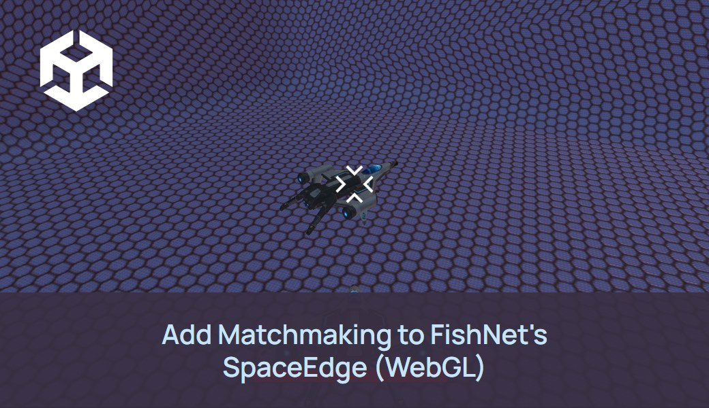

# FishNet on Edgegap

This sample shows how to host a Unity game built with [FishNet](https://github.com/FirstGearGames/FishNet) on Edgegap dedicated servers, with WebGL and desktop clients and optional matchmaking through the [Edgegap Matchmaker](https://docs.edgegap.com/learn/matchmaking). The game client never calls the Edgegap API and never holds an API token: the matchmaker starts the servers, and each server stops itself when no one joins or everyone leaves.

## Project

| Folder | FishNet | Unity | What it shows |
|---|---|---|---|
| `Fishnet_v4.1.6R_WebGL_Matchmaker` | 4.1.6R (Bayou) | 2021.3.45f2 | WebGL and desktop clients, servers that stop themselves, and no API token in the client. Connects directly to a server by default; the Edgegap Matchmaker is an opt-in toggle. See its [README](Fishnet_v4.1.6R_WebGL_Matchmaker/README.md). |

The Unity column is the editor version the project was saved with (`ProjectSettings/ProjectVersion.txt`).

### Unity version

Open the project with Unity `2021.3.45f2`, the exact version it was built with.

### Playing alone

**Playing alone:** matchmaking is off by default, so a single client connects directly to `localhost:7770` (or the server address you set) and plays on its own. With the matchmaker turned on, the shipped `matchmaker-config.json` (matchmaker `3.3.2`) matches 2 to 4 players, with a 20 s expansion that lowers the minimum to 1 and a 30 s ticket expiration. Test the matchmaker with two clients.

### Known limitation

**Known limitation:** the server does not check that a connecting player holds a matchmaker ticket for this match, so anyone who learns the server address can join. Deployments stop themselves when no one joins or everyone leaves, which limits cost. Before production, validate each player against the match's tickets (`MM_TICKET_IDS` / the matchmaker API) or an auth token.

## Tutorial

To make sure the project opens correctly in the Unity editor, clone the repo with `git clone https://github.com/edgegap/netcode-game-sample-unity-fishnet-hashgrid`.

Open the `Fishnet_v4.1.6R_WebGL_Matchmaker` folder with the Unity Hub, then follow its [README](Fishnet_v4.1.6R_WebGL_Matchmaker/README.md).

The full walkthrough is in the Edgegap docs: [FishNet WebGL](https://docs.edgegap.com/docs/sample-projects/fishnet-webgl). For FishNet on Edgegap in general, see [FishNet](https://docs.edgegap.com/docs/sample-projects/fishnet-on-edgegap).

## Edgegap packages

| Project | Package | Version |
|---|---|---|
| `Fishnet_v4.1.6R_WebGL_Matchmaker` | [Edgegap Unity SDK](https://github.com/edgegap/edgegap-unity-sdk) (`com.edgegap.unity-sdk`) | tag `3.5.6` |
| `Fishnet_v4.1.6R_WebGL_Matchmaker` | [Edgegap Unity plugin](https://github.com/edgegap/buildtool-unity-plugin) (`com.edgegap.unity-servers-plugin`) | tag `3.2.2` |

## Asset Store packages

The project bundles these free third-party packs. Their authors keep their rights; they are not covered by this repository's MIT licence. If you reuse them outside this sample, get them from their source and follow their terms.

| Pack | Folder in the project | Source | Licence |
|---|---|---|---|
| Cartoon FX Free, by Jean Moreno (JMO) | `Assets/JMO Assets/` | Unity Asset Store, now [Cartoon FX Remaster Free](https://assetstore.unity.com/packages/p/cartoon-fx-remaster-free-109565) (the old effects are in its legacy folder) | Standard Unity Asset Store EULA |
| Star Sparrow Modular Spaceship | `Assets/StarSparrow/` | [Unity Asset Store](https://assetstore.unity.com/packages/3d/vehicles/space/star-sparrow-modular-spaceship-73167) | Standard Unity Asset Store EULA |
| Starfield Skybox, by Pulsar Bytes | `Assets/Starfield Skybox/` | [Unity Asset Store](https://assetstore.unity.com/packages/2d/textures-materials/sky/starfield-skybox-92717) | Standard Unity Asset Store EULA |
| Total JSON, by Leguar | `Assets/TotalJSON/` | Unity Asset Store ([publisher page](https://assetstore.unity.com/publishers/21809)) | Standard Unity Asset Store EULA |
| Sci-Fi Sfx (sound effects), by Little Robot Sound Factory | `Assets/Sci-Fi-Sfx/` | [OpenGameArt](https://opengameart.org/content/sci-fi-sound-effects-library) (the Asset Store listing is no longer available) | CC-BY 3.0; credit Little Robot Sound Factory, [www.littlerobotsoundfactory.com](http://www.littlerobotsoundfactory.com) |

## License

Code written by Edgegap in this repository is released under the [MIT License](LICENSE). Bundled third-party code and assets (FishNet, its plugins, TextMesh Pro resources and the packs above) keep their own licences, listed in the THIRD-PARTY section of [LICENSE](LICENSE). FishNet in particular uses its own licence, not MIT.
