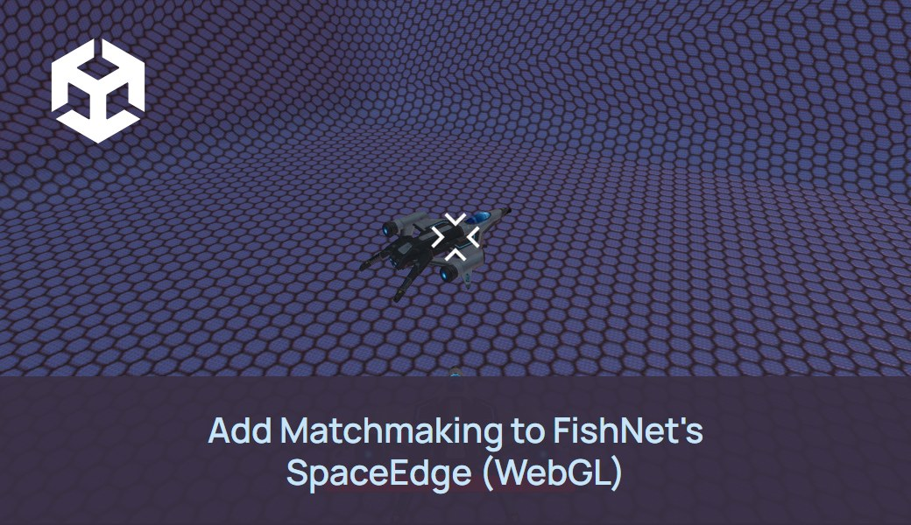

# FishNet on Edgegap

This guide will help you create a headless server on Edgegap for a Unity project using [Fishnet](https://github.com/FirstGearGames/FishNet) as its networking solution. Different versions of the sample are available depending on which version of Fishnet is used.

The older projects are built around the “MatchmakingSystem” script. This script communicates with the Edgegap API to find live deployments of the available server for the game and if no available servers are found then it requests the Edgegap API to deploy a new instance of the game’s server for the client based on their location. This script explains the core concepts of communicating with the Edgegap API using the Unity HTTP Requests system and utilizing the data sent by the Edgegap API for making decisions for the game’s matchmaking.
This game auto connects to the first instance found on the list of all the live server deployments for the game, this is to make testing easier and due to the fact that Edgegap free tier allows only 1 live server deployment for the game at a given time. But if a user is not using free tier then this matchmaking system can be really easily extended to give players an option to choose from all the available servers to connect to.

The recommended project, `Fishnet_v4.1.6R_WebGL_Matchmaker`, does not call the Edgegap API from the client (see below).

## Projects

| Folder | FishNet | Unity | What it shows |
|---|---|---|---|
| `Fishnet_v4.1.6R_WebGL_Matchmaker` | 4.1.6R (Bayou) | 2021.3.45f2 | **Recommended.** WebGL and desktop clients, servers that stop themselves, and no API token in the client. Connects directly to a server by default; the [Edgegap Matchmaker](https://docs.edgegap.com/learn/matchmaking) is an opt-in toggle. See its [README](Fishnet_v4.1.6R_WebGL_Matchmaker/README.md). |
| `Fishnet_v4.1.6R_WebGL` | 4.1.6R (Bayou) | 2021.3.16f1 | WebGL client, `MatchmakingSystem` calling the Edgegap API directly. |
| `Fishnet_v4.1.6R_EdgegapMatchmaker` | 4.1.6R (Tugboat) | 2021.3.16f1 | Legacy matchmaker (`selectors`/`filters` config). That config format isn't accepted by the current matchmaker, so use `Fishnet_v4.1.6R_WebGL_Matchmaker` instead. |
| `Fishnet_v3.11.14`, `Fishnet_v2.5.2` | 3.x / 2.x (Tugboat) | 2021.3.10f1 | `MatchmakingSystem` calling the Edgegap API directly. |

The Unity column is the editor version each project was saved with (`ProjectSettings/ProjectVersion.txt`).

**Do not use the `MatchmakingSystem` pattern in production.** In `Fishnet_v4.1.6R_WebGL`, `Fishnet_v3.11.14` and `Fishnet_v2.5.2`, the game client calls the Edgegap API itself, with an Edgegap API token typed into the `AuthHeaderValue` field of `MatchmakingSystem` (`Fishnet_v4.1.6R_EdgegapMatchmaker` still contains the script, though its scenes don't use it). The repository ships only a placeholder there, but the field is still there: any token you put in it ends up in every build, anyone with a build can read it, and it grants full access to your Edgegap account. Only use these projects for local testing with a token you can revoke. Real games should let a matchmaker or a backend you control start servers, as `Fishnet_v4.1.6R_WebGL_Matchmaker` does.

### Unity version

The recommended project was tested with Unity `2021.3.45f2`; open it with that exact version. Unity 2021.3 is out of Unity's support window. Newer editors (2022.3 LTS, Unity 6) are untested for this sample, and the project has not been upgraded to them. The older projects were saved with earlier 2021.3 patch releases (see the table) and have not been re-tested.

### Playing alone

**Playing alone:** matchmaking is off by default in `Fishnet_v4.1.6R_WebGL_Matchmaker`, so a single client connects directly to `localhost:7770` (or the server address you set) and plays on its own. With the matchmaker turned on, the shipped `matchmaker-config.json` (matchmaker `3.3.2`) matches 2 to 4 players, with a 20 s expansion that lowers the minimum to 1 and a 30 s ticket expiration. With the earlier 5-minute expiration, a lone ticket in our tests did not get a server at the expansion; it only reached `HOST_ASSIGNED` around its expiration. The 30 s expiration keeps that wait short; the lone-player case was not re-tested with it. Test the matchmaker with two clients.

### Known limitation

**Known limitation:** the server does not check that a connecting player holds a matchmaker ticket for this match, so anyone who learns the server address can join. Deployments stop themselves when no one joins or everyone leaves, which limits cost. Before production, validate each player against the match's tickets (`MM_TICKET_IDS` / the matchmaker API) or an auth token.

## Tutorial

To make sure the projects open correctly in the Unity editor, clone the repo via the `git clone [URL]` command. 

To test a sample project, select one of the available folders and open it with the Unity Hub.

You can see the full documentation for the [base Fishnet example here](https://docs.edgegap.com/docs/sample-projects/fishnet-on-edgegap) or for [Fishnet with WebGL here](https://docs.edgegap.com/docs/sample-projects/fishnet-webgl).

## Edgegap packages

| Project | Package | Version |
|---|---|---|
| `Fishnet_v4.1.6R_WebGL_Matchmaker` | [Edgegap Unity SDK](https://github.com/edgegap/edgegap-unity-sdk) (`com.edgegap.unity-sdk`) | tag `3.5.6` |
| the other projects | [Edgegap Unity plugin](https://github.com/edgegap/edgegap-unity-plugin) (`com.edgegap.unity-servers-plugin`) | pinned to the commit already recorded in each project's `Packages/packages-lock.json` |

## Asset Store packages

Every project folder bundles the same free third-party packs. Their authors keep their rights; they are not covered by this repository's MIT licence. If you reuse them outside this sample, get them from their source and follow their terms.

| Pack | Folder in each project | Source | Licence |
|---|---|---|---|
| Cartoon FX Free, by Jean Moreno (JMO) | `Assets/JMO Assets/` | Unity Asset Store, now [Cartoon FX Remaster Free](https://assetstore.unity.com/packages/p/cartoon-fx-remaster-free-109565) (the old effects are in its legacy folder) | Standard Unity Asset Store EULA |
| Star Sparrow Modular Spaceship | `Assets/StarSparrow/` | [Unity Asset Store](https://assetstore.unity.com/packages/3d/vehicles/space/star-sparrow-modular-spaceship-73167) | Standard Unity Asset Store EULA |
| Starfield Skybox, by Pulsar Bytes | `Assets/Starfield Skybox/` | [Unity Asset Store](https://assetstore.unity.com/packages/2d/textures-materials/sky/starfield-skybox-92717) | Standard Unity Asset Store EULA |
| Total JSON, by Leguar | `Assets/TotalJSON/` | Unity Asset Store ([publisher page](https://assetstore.unity.com/publishers/21809)) | Standard Unity Asset Store EULA |
| Sci-Fi Sfx (sound effects), by Little Robot Sound Factory | `Assets/Sci-Fi-Sfx/` | [OpenGameArt](https://opengameart.org/content/sci-fi-sound-effects-library) (the Asset Store listing is no longer available) | CC-BY 3.0; credit Little Robot Sound Factory, [www.littlerobotsoundfactory.com](http://www.littlerobotsoundfactory.com) |

## License

Code written by Edgegap in this repository is released under the [MIT License](LICENSE). Bundled third-party code and assets (FishNet, its plugins, TextMesh Pro resources and the packs above) keep their own licences, listed in the THIRD-PARTY section of [LICENSE](LICENSE). FishNet in particular uses its own licence, not MIT.
